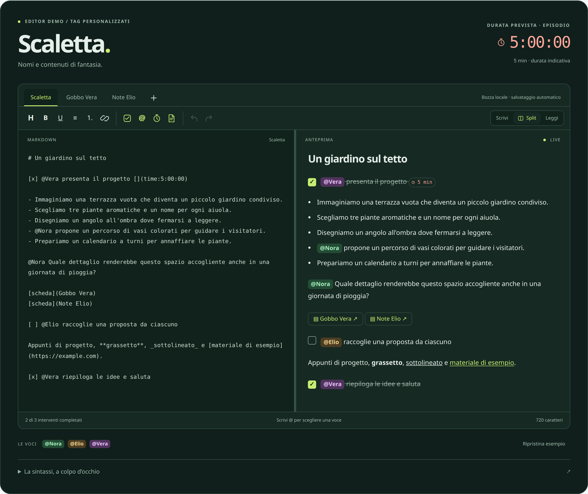

# Anteprime del sample podcast

Rendering reali dell'editor in Chromium, esportati in PNG a risoluzione doppia
per la condivisione. Nomi, titoli e documenti sono interamente di fantasia.

| Immagine | Contenuto |
|---|---|
| [01-editor-split-desktop.png](01-editor-split-desktop.png) | Scaletta e anteprima affiancate; un solo tag time, totale 5 minuti |
| [02-scelta-partecipante.png](02-scelta-partecipante.png) | Menu di scelta Nora, Elio e Vera dopo aver digitato `@` |
| [03-durata-sezione.png](03-durata-sezione.png) | Inserimento guidato di minuti, secondi e centesimi |
| [04-documento-collegato.png](04-documento-collegato.png) | Il gobbo di Vera aperto come documento separato |
| [05-editor-split-mobile.png](05-editor-split-mobile.png) | Split verticale su uno schermo stretto |

Anteprima interattiva locale: <http://localhost:4173/podcast/>.

Per rigenerare le immagini dopo una modifica:

```sh
npm run site:build
npm run site:serve
# In un secondo terminale, dalla radice del repository:
node previews/podcast/capture.mjs
```


