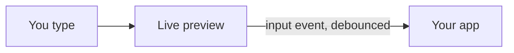

## Edit me

This is a real `<mdlib-editor>`: the preview renders **on every keystroke**, in your browser.
Select a word and press Ctrl+B, or use the toolbar; *Write* and *Preview* switch the view.

- [x] every plugin, with `plugins` set to `all`
- [ ] your own text

KaTeX is loaded on first use: $e^{i\pi} + 1 = 0$.

::: tip Diagrams
Mermaid loads only when a diagram appears, and a diagram is drawn again only when its source changes.
:::

