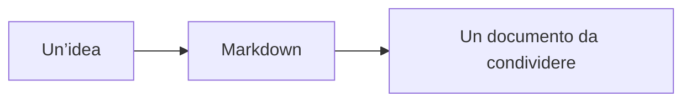

# Un documento, tante possibilità

Benvenuto nella demo di **mdlib-pure**. Seleziona del testo e usa la barra
per formattarlo, oppure scrivi direttamente in Markdown.

> [!TIP]
> Parti da **Split** per vedere il risultato mentre scrivi. Passa a
> **Leggi** per concentrarti sul documento, o a **Scrivi** per avere più spazio.

## Dall’idea al documento

- [x] Testo in **grassetto**, *corsivo*, ~~barrato~~ e ==evidenziato==
- [x] Tabelle, citazioni, note e blocchi di codice
- [ ] Esporta il tuo documento in MD, HTML o PDF

| Modalità | Per cosa usarla |
| :--- | :--- |
| Scrivi | Concentrati sul testo |
| Split | Scrivi con l’anteprima in tempo reale |
| Leggi | Rileggi il risultato finale |

## Formule e diagrammi

Una formula inline: $E = mc^2$.



## Un’API essenziale

```js
const md = createMarkdown({ plugins: gfm() })
md.renderTo(element, source)
```

::: note Anche i dettagli contano
Cambia tema dal menu in alto: il documento e i diagrammi si adattano.
I pulsanti della barra attivano il plugin necessario automaticamente.
:::

Markdown
: Un formato di testo semplice, leggibile anche senza un editor.

Il contenuto resta nel tuo browser; la bozza viene salvata localmente.[^bozza]

[^bozza]: «Condividi» include il testo nel link. «PDF» apre la stampa del browser: scegli **Salva come PDF**.
